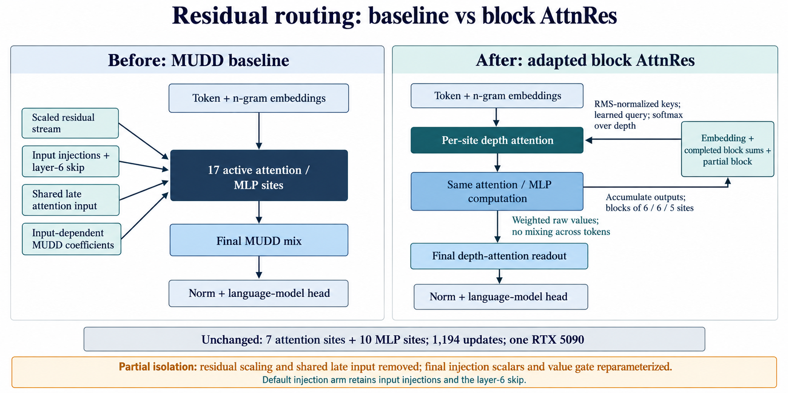

# Residual-routing experiments (awaiting GPU validation)



[Notion experiment and results](https://app.notion.com/p/4000b758a24e81fbb15dc3b62f07d765).
Diagram is conceptual: the no-cross-token-mixing label applies to depth routing, not self-attention.

Reference branch: `baseline`, training commit `5be1ba0`.
Experiment branch: `experiment/attention-residuals`, created directly from baseline.
Future experiments must branch from baseline, not from this experiment.
Publish `baseline` and the experiment branch; retain remote `rtx-local-v2` for compatibility.

## Three separate modes

| RTX_ROUTING | Definition |
| --- | --- |
| baseline (default) | Original MUDD forward and parameter initialization, unchanged. |
| static | Only the final-layer MUDD and post-loop grouped coefficients become learned constants. Their bias initialization is retained; grouped constants are a dedicated `mudd_static_deltas` (14 x 12, zero init, `mudd_w2g`'s optimizer settings). Other MUDD gates remain input-dependent. |
| block_attnres | Replace residual-stream routing with softmax attention over completed block sums and the current partial block. Not stacked on the old MUDD residual paths. `RTX_ATTNRES_INJECT=1` (default) keeps the x0/n-gram injections and layer-6 skip; `0` drops them too. |

Block AttnRes follows the [official paper/pseudocode](https://github.com/MoonshotAI/Attention-Residuals).
Each active attention/MLP site has one learned query; a final readout has its own. The key RMSNorm
weight is folded into the query (logits only see their product). Queries start at zero (uniform depth
weights); values remain unnormalized. Each completed block's per-token 1/RMS is computed once, when the
block closes. Scores/softmax use FP32, weighted values use the activation dtype. States are local to one forward.
Default block size: six active serial sublayers. There are 17 sites (7 attention, 10 MLP),
forming blocks of 6/6/5 plus the initial embedding source. Layer 8's parallel MLP outputs are
summed as one site. Routing is per token, never across sequence positions.

Always replaced in block mode: residual scaling (resid lambdas), shared late attention input
(layers 8 and 10 read norm(cache[7]) in the baseline), last-layer MUDD residual/value recombination
and post-loop MUDD mix.
With `RTX_ATTNRES_INJECT=1` (default) the gated x0 / n-gram injections and the layer-6 skip are kept:
each is added to the open block like a sublayer output without counting as a site, and the skip
re-adds the summed stream after layer 3 (the baseline's `cache[3]`). Layer 10's `mu[10] * cache[0]`
and `mu[11] * n-gram` terms become `attnres_last_inject`: two learned scalars at MUDD's initial values
(0, 0.05), not per-token. With `0` all of these are dropped (the original arm).

**Isolation is partial, not "only routing".** Even with injections on, this arm still differs from the
baseline in: residual scaling, the shared late attention input, per-token vs. scalar layer-10
injection lambdas, and a new layer-10 value-gate parameterization. Attribute results to "block AttnRes
as adapted here", not to depth routing alone.
Retained: initial ngram injection, attention head/XSA gates, value embeddings, output gains,
all active attention/MLP blocks, FP8 kernels, windows and loss. The last layer's value-embedding gate
is a new parameterization, `2 + linear(gate_in)` per head (`attnres_ve_gate`, zero init = MUDD's initial
factor 2); it is not MUDD's original per-token gate restored.
Layer 4's depth mix is computed once for the post gate and the MLP unless an injection changes it.
This is an architectural adaptation, not a bitwise-equivalent optimization or exact paper reproduction.
Unused original parameters remain allocated to preserve common initialization and optimizer bookkeeping;
parameters without gradients are skipped.

New queries use existing replicated Adam: base LR 0.008 × 0.25, betas (0.9, 0.99), no weight
decay; `attnres_ve_gate` copies `ve_gate_bank`'s settings. Existing two-step accumulation/schedule.
They remain FP32; existing tail averages still apply to the original parameter groups only.
No updates/layers are reduced. Keep 1194 updates, all five seeds and validation packing fixed.

## First cluster check (after review and publication)

```bash
source ~/venvs/nanogpt/bin/activate
cd ~/speed-run/modded-nanogpt
git fetch origin
git switch experiment/attention-residuals
git pull --ff-only origin experiment/attention-residuals
python -u tests/check_rtx5090.py --routing block_attnres --block-size 6 --seed 999
```

Add `--attnres-inject 0` to check the arm without injections.

Run on one allocated RTX 5090. The checker explicitly selects the variant (environment
flags alone are cleared by this test), warms every stage, runs two full updates and validation,
checks finite losses/gradients/weights, routing gradients and actual query updates, and memory.
It does not upload. Repeat with `--routing static` for the simpler ablation.
The test is not a speed or quality measurement. GPU FP8/Inductor compatibility remains unverified locally.

## First full pilot, only after the check passes

```bash
unset RTX_MAX_STEPS RTX_PREFLIGHT NUM_SCHEDULED_ITERATIONS
export TRAIN_SEED=999 RTX_ROUTING=block_attnres RTX_ATTNRES_BLOCK_SIZE=6 RTX_ATTNRES_INJECT=1
export RTX_MICROBATCH_TOKENS=16384 RTX_NGRAM_DIVISOR=32
export RTX_VAL_SEQ_LEN=65536 RTX_EVAL_CE_SLAB_ROWS=4096
export RTX_WARMUP_MICROBATCHES=2 RTX_MIN_HEADROOM_GIB=1.5
export RTX_WANDB_UPLOAD=1
export WANDB_UPLOAD_PYTHON="$HOME/venvs/wandb-upload/bin/python"
bash run_rtx.sh
```

W&B name: `block-attnres-b6-1gpu-seed-999` (`-noinject` suffix with `RTX_ATTNRES_INJECT=0`; static mode: `static-1gpu-seed-999`).
Logs/uploader record mode and block size. They must never be grouped into baseline results.
If pilot quality is promising, confirm on seeds 999–1003 against mean loss 3.2948572
and time 861.635 s. Compare paired results; do not assume reduced step count is beneficial.
Consider shorter schedules or fewer blocks only after quality improves.

One full seed-999 run after the smoke test is enough for initial screening, not for a performance claim.
If promising, complete seeds 1000-1003 (five total, not five additional runs). Seed 999 counts only if
the candidate commit and settings remain unchanged. After tuning, start a new candidate series.
Report mean/sample SD and paired differences in final validation loss and recorded time; retain
warnings and failed attempts. Small timing differences need contemporaneous baseline reruns because
the existing five sequential runs do not measure variation across cluster sessions.
